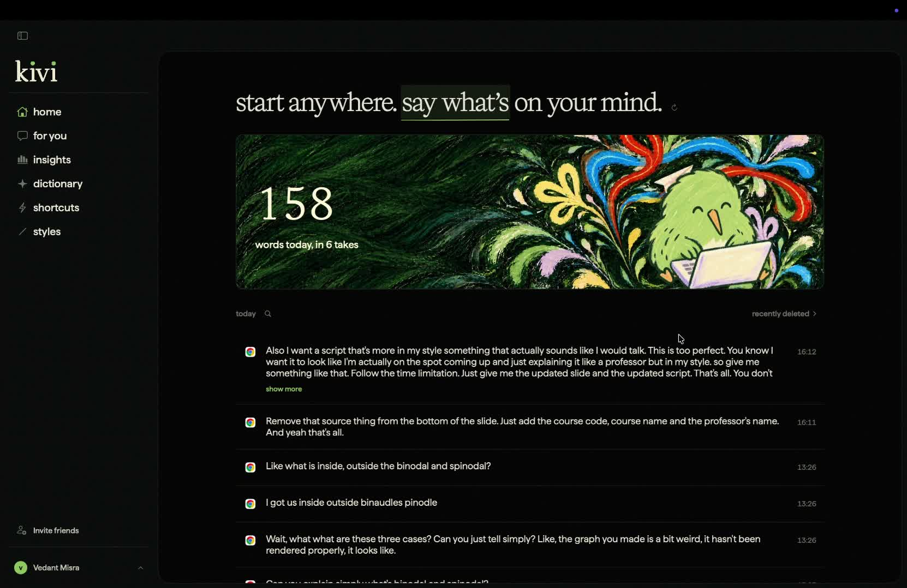

# Kivi

[](https://github.com/orcus108/kivi/raw/refs/heads/main/assets/kivi-demo.mp4)

[Watch the demo](https://github.com/orcus108/kivi/raw/refs/heads/main/assets/kivi-demo.mp4)

A native macOS dictation prototype exploring how you teach an app to write the way you want.

- Dictate into your apps.
- Tell **For You** how you want your text to sound.
- Preview preferences before saving, then review or remove them later.

## Build

Requires an Apple Silicon Mac, Xcode and Python 3.

```sh
zsh app/scripts/build.sh
zsh app/scripts/test.sh
```

This compiles an unsigned app without installing it. Models and original Kivi artwork/fonts aren't included. [Setup details](docs/BUILD.md).

Built on [TypeWhisper v1.7.1](https://github.com/TypeWhisper/typewhisper-mac), under [GPL-3.0-or-later](LICENSE). An independent study inspired by Kivi, unaffiliated with Sarvam AI or TypeWhisper. [Attribution](app/foundation/UPSTREAM.md).

[Contributions](docs/CONTRIBUTIONS.md) · [Verification](docs/VERIFICATION.md)
